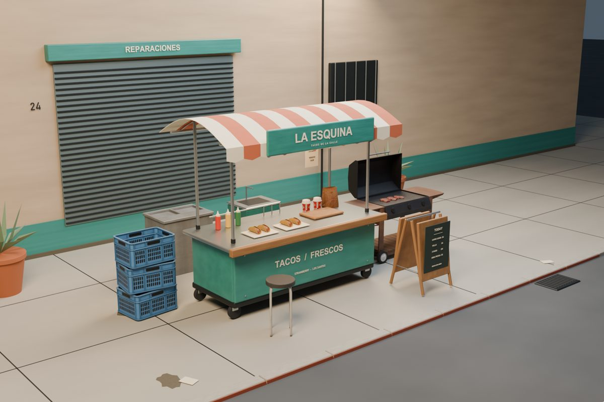
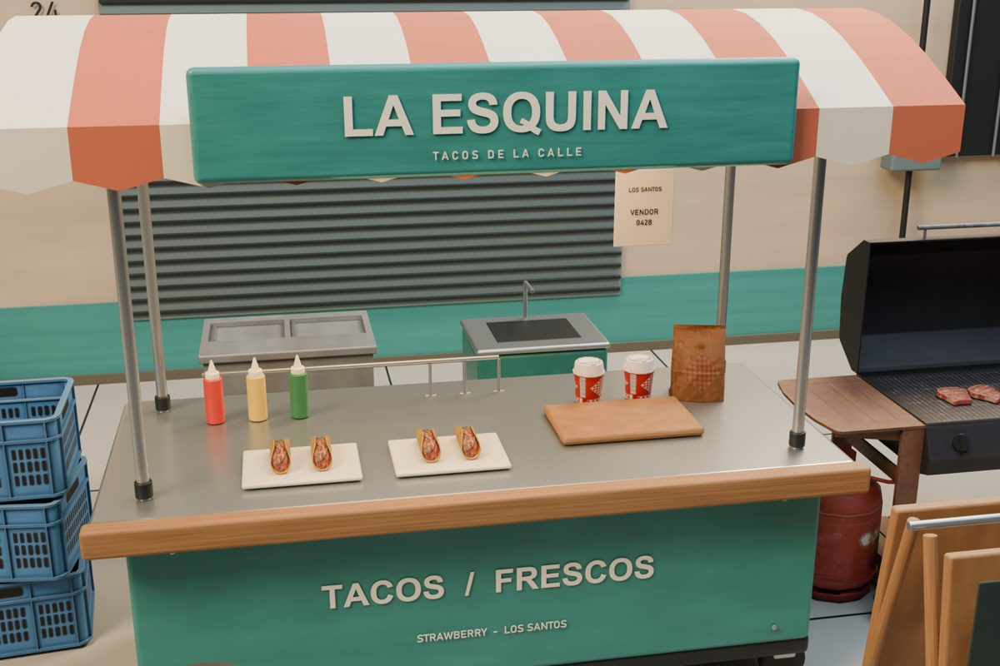
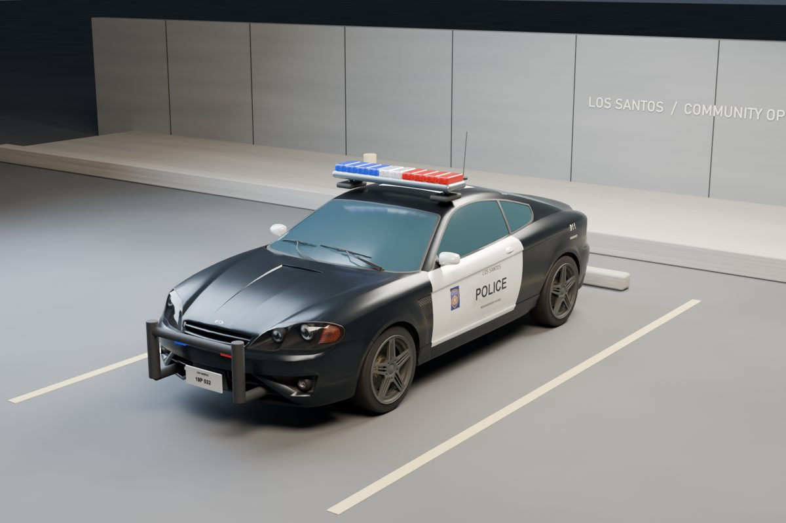
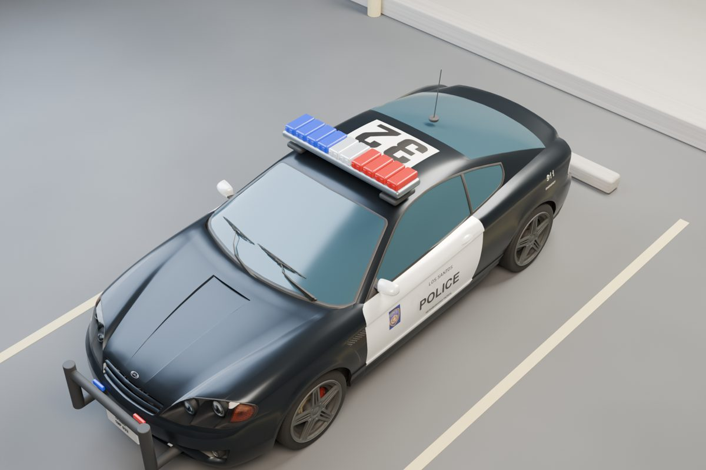

# GTAV Scout

**Find and inspect GTA V's own models and textures, so your AI can build with them.**

Describe what you want to make — a roadside stand, a shop interior, a converted
vehicle — and your agent searches the game's archetypes and texture dictionaries,
renders previews of the candidates, looks at them, and builds the result in
Blender.

A GTA V adaptation of [gta-scout](https://github.com/Dryxio/gta-scout), which does
the same for San Andreas. The catalogue, evidence and review layers are its work;
the parts that read GTA V's own formats are new.

**Early alpha.** Needs an AI coding agent that can read and write files and run
commands, including Blender. A chat that only gives you instructions cannot do this.

**[Get started with your AI](#get-started-with-your-ai) · [Extract the game assets](#extract-the-game-assets) · [Manual setup](#requirements) · [Agent guide](AGENTS.md) · [Blender guide](docs/blender-cli.md)**

## Showcase

Built by an AI agent with this tool and Blender: game props and textures found
through the catalogue, plus new geometry where the game had nothing suitable.
Blender renders, not in-game screenshots; the build scripts for these particular
scenes are not included.

### La Esquina — a taco stand in Strawberry

| Street view | Counter detail |
| --- | --- |
|  |  |

### LSPD patrol car conversion

| Front three-quarter | Roof and equipment |
| --- | --- |
|  |  |

## Get started with your AI

Give your agent this repository and tell it what you want. It can check your setup,
install what is missing and build the result; it will ask you for what only you can
do, such as exporting the game files. Copy this into your agent:

> Help me set up https://github.com/mert-ayhan/gtav-scout. Read README.md
> and AGENTS.md, check what is already installed on my computer and help
> me install what is missing (.NET SDK, CodeWalker, Python with uv, Blender with
> Sollumz). Ask me where my GTA V installation and my OpenIV export are. Then build
> a small street-food stand in GTA V style from the game's own props and textures,
> save an editable .blend with rendered previews, and show me the result.

Your AI provider may charge separately for the agent's usage.

## Extract the game assets

**This repository contains no game data, and none can be downloaded from it.** Every
user exports the assets from their own copy of GTA V; the catalogue, previews and
textures are then built locally from that export. Game files, the SQLite catalogue
and decoded pixels are Rockstar's content and stay out of git (`.gitignore` covers
`output/` and every GTA file type).

1. Install [OpenIV](https://openiv.com/) and open your GTA V (Legacy) installation.
2. Search the whole game for each file mask below, select all results and use
   **Export selected** into one folder, e.g. `D:\gtav-assets`. Folder layout does
   not matter; the scanner recurses.

   | Stage | Mask | Gives |
   | --- | --- | --- |
   | A | `*.ytyp`, `*.ymap` | model catalogue and map placements: search works |
   | B | `*.ytd` | texture catalogue and decoded pixels |
   | C | `*.ydr`, `*.ydd`, `*.yft` | drawables for Blender previews |
   | D | `*.meta` | vehicles become searchable (`vehicles.meta`) |

   Stages A and D are small and enough to start searching; a full export is about
   282k files and 69 GB, so leave disk space.
3. Pass that folder as `--asset-root` to every command. Always the whole export,
   never a subfolder: names are rebuilt from the file listing.

Exporting into one folder makes OpenIV rename collisions to `name(1).ext`; the tool
handles that. A game update invalidates the export: re-export and rebuild. Details
and checks: [docs/manual-verification.md](docs/manual-verification.md).

## Requirements

- **GTA V, Legacy edition.** Enhanced (`GTA5_Enhanced.exe`) is unsupported.
- **.NET 10 SDK** and a local [CodeWalker](https://github.com/dexyfex/CodeWalker)
  checkout, built, with `CODEWALKER_PATH` pointing at it. Not bundled.
- **Python 3.12** and [`uv`](https://docs.astral.sh/uv/).
- **Blender 4.2+** with [Sollumz](https://github.com/Sollumz/Sollumz), for previews.
  Verified with Sollumz 2.9.0 on Blender 5.2.1.
- Very likely **OpenIV**, to export assets — see *Reading the game* below.

## Install

    git clone https://github.com/mert-ayhan/gtav-scout && cd gtav-scout
    uv venv --python 3.12 .venv
    uv pip install --python .venv/Scripts/python.exe -e .
    export CODEWALKER_PATH=/path/to/CodeWalker
    dotnet run --project tools/GtavScout.Extract -- --self-test

## Reading the game

There are two asset sources, and which one you get is measured, not chosen.

    dotnet run -c Release --project tools/GtavScout.Extract -- \
      keys --game-root "<GAME ROOT>"

CodeWalker finds GTA V's archive keys by hashing byte ranges of `GTA5.exe`. When
that works, the tool reads the RPF archives directly and you pass `--game-root`
throughout.

When it reports `ngKeysMissing`, this game build no longer exposes the NG key
material CodeWalker looks for, and the archives cannot be opened. Add `--probe 1`
for the detail. **Measured on 2026-09-10 against game build 1.0.3889.0 with
CodeWalker master from 2025-04-11: the AES key and hash LUT are found, but 0 of 101
NG keys and 0 of 272 decrypt tables are, and zero archives mount.** CodeWalker's
last release predates that game build by about fifteen months and "keys not found"
is a known open issue there.

In that case export the assets with OpenIV as in
[Extract the game assets](#extract-the-game-assets) and pass `--asset-root`. Only the archive layer needs
keys, so nothing else about the pipeline changes — and if CodeWalker catches up,
the RPF path works again with no other change.

## Use

    # 1. Catalogue the game's metadata
    .venv/Scripts/gtav-catalog-sources.exe \
      --asset-root "<EXPORT DIR>" --out output/gta5-source

    # 2. Import it and search
    .venv/Scripts/gtav-catalog.exe --db output/gta5.sqlite build \
      --root output/gta5-source --game gta5
    .venv/Scripts/gtav-catalog.exe --db output/gta5.sqlite search 'office desk' \
      --kind model --limit 20

    # 3. Pull candidates out and render four views of each
    dotnet run -c Release --project tools/GtavScout.Extract -- extract \
      --asset-root "<EXPORT DIR>" --catalog-root output/gta5-source \
      --out output/gta5-extract --id prop_bench_01a

    blender -b --python scripts/render-asset-catalog-views.py -- \
      --input output/gta5-extract/input.json --output output/gta5-previews

    # 4. Look at the renders, review them, index the reviews
    .venv/Scripts/gtav-catalog-visual.exe --db output/gta5.sqlite prepare \
      --keys output/keys.json --overrides output/overrides.json --out output/packets
    .venv/Scripts/gtav-catalog-visual.exe --db output/gta5.sqlite import \
      --manifest <FROM latest.json> --responses output/responses.json
    .venv/Scripts/gtav-catalog-semantic.exe --db output/gta5.sqlite build

Full workflow and the rules an agent must follow: [AGENTS.md](AGENTS.md).

## Worked examples

Two builds that use the tool the way it is meant to be used — search, render,
*look*, then construct. Each saves an editable `.blend` next to its renders.

    # A stock Prairie converted into an LSPD patrol car
    dotnet run -c Release --project tools/GtavScout.Extract -- extract \
      --asset-root "<EXPORT DIR>" --out output/veh --drawable prairie --drawable police
    blender -b --python examples/build_police_prairie.py -- \
      --input output/veh/input.json --out output/build-police

    # A street-food stand assembled from props plus new geometry
    dotnet run -c Release --project tools/GtavScout.Extract -- extract \
      --asset-root "<EXPORT DIR>" --catalog-root output/gta5-source --out output/stand \
      --id cs1_06_market_canopy_03 --id prop_protest_table_01 --id prop_kebab_grill \
      --id prop_bbq_4_l1 --id hei_prop_heist_wooden_box --id v_med_cooler \
      --id prop_food_tray_02 --id v_ret_247_fruit --id sf_prop_sf_chair_stool_09a \
      --id prop_box_wood05a
    blender -b --python examples/build_street_food_stand.py -- \
      --input output/stand/input.json --out output/build-stand

The vehicle example uses `--drawable` rather than `--id`: vehicles are declared in
`vehicles.meta`, not in a YTYP, so they never reach the archetype catalogue even
though their drawables are in the export.

## What works in this alpha

- Archetypes from every YTYP, with DLC overrides resolved by load order, and real
  dimensions from archetype bounding boxes — which San Andreas never had.
- Texture occurrences from every YTD, each keeping its source dictionary.
- Map placements from every YMAP, indexed per archetype.
- Incremental SQLite/FTS5 import, bilingual lexical hints, game/kind/dimension
  filters, provenance and explicit partial matches.
- Local multilingual text embeddings, stale-vector exclusion, hybrid rank fusion.
- Immutable evidence packets, blind contact sheets, confidence and ambiguity
  tracking, evidence-hash checks, query-specific shortlists.
- Four-view Blender previews with blank-render detection and a source-hash cache.

## Limits

**Coverage is incomplete, and this tool does not pretend otherwise.**

- A metadata import is not a visual review. An asset nobody has looked at has no
  visual meaning in the index, whatever its name suggests.
- **About half the archetypes have no readable name, and that is expected.** GTA V
  stores names as hashes; the tool rebuilds the index from your export's file
  names, which resolves 83,634 of 159,380. Of the rest, 99.5% are drawables packed
  inside `_slod_children`-style dictionaries — distance stand-ins, not props — and
  their names exist nowhere public. Prop coverage of the named half is effectively
  complete: 97.1% of a 21,631-entry public object list is present, and the only
  absentees are weapons, which are not archetypes. Records carry `nameResolved`.
- Placements come from YMAP entities, so the 36.7% of named archetypes with none
  are those placed through interiors or spawned by script, not missing data.
- Absence from a shortlist is not proof an asset does not exist.
- Vehicle fragments (`.yft`) are structured differently from `.ydr` drawables and
  are a known rendering gap.
- Extraction is manual while the key material is unavailable, and a game update
  invalidates an export, the catalogue built from it, and any review keyed to
  changed bytes.
- `asset_catalog_uv_context.py`, upstream's UV-over-texture diagnostic, is not
  ported: it reads DFF geometry through DragonFF, and a GTA V equivalent needs a
  YDR geometry reader. Nothing else depends on it.
- No hosted preview service, catalogue or vision worker exists. Your agent's model
  usage, review time and render compute are separate costs.
- Semantic search only reaches assets someone has reviewed. Every response reports
  its coverage; read it, because a fresh catalogue has ten reviewed assets against
  159,380 in scope.
- Measured on one machine against build 1.0.3889.0: a 69 GB export becomes a
  159,380-model, 316,565-texture catalogue in about five minutes of scanning plus
  94 seconds of import, and previews render at roughly 1.6 s per asset. See
  `docs/architecture.md`; measure your own before planning a full campaign.

## Tests

    .venv/Scripts/python.exe -m unittest discover -s tests -p 'test_*.py'
    dotnet run --project tools/GtavScout.Extract -- --self-test

189 synthetic tests, needing neither the game nor a network. Some skip without
optional tooling: set `BLENDER_PATH` to exercise the render rig, `CODEWALKER_PATH`
for the cross-language PNG check, and install `.[semantic]` for shortlisting.
Checks that need the real game are manual and listed in
`docs/manual-verification.md`.

## License

Tool code: [MIT](LICENSE). CodeWalker, Sollumz, game binaries, texture pixels and
annotation datasets are not bundled — see [THIRD_PARTY_NOTICES.md](THIRD_PARTY_NOTICES.md).
Not affiliated with Rockstar Games or Take-Two Interactive.
